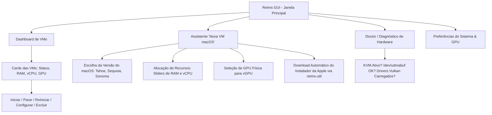
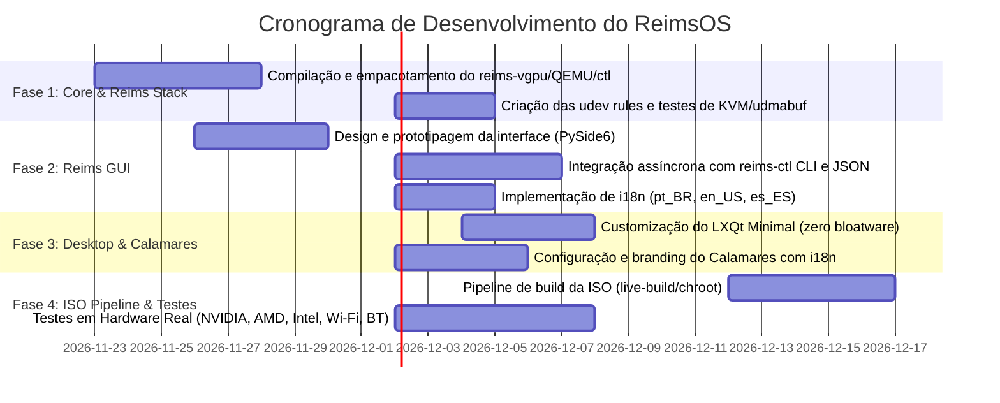

# ReimsOS: Plano de Engenharia e Arquitetura

> **Resumo Executivo:**  
> Este documento detalha a viabilidade técnica, arquitetura de software e o roteiro completo de implementação para o desenvolvimento do **ReimsOS**: uma distribuição Linux baseada em **Ubuntu 24.04 LTS**, ultraleve, sem bloatware, focada em virtualização de alto desempenho para macOS com aceleração gráfica via [reims-vgpu](https://github.com/steelbrain/reims-vgpu), instalador gráfico moderno com suporte internacional (i18n), suporte abrangente a GPUs (NVIDIA, AMD, Intel) e uma aplicação GUI nativa para o `reims-ctl`.

---

## 1. Visão Geral e Objetivos do Sistema

O objetivo do **ReimsOS** é fornecer um sistema operacional "turnkey" (ligar e usar) para usuários que desejam executar máquinas virtuais macOS no Linux com suporte de aceleração gráfica por hardware (Vulkan/Metal via `reims-vgpu`), sem precisar passar pelas complexidades de compilação de kernels, drivers Vulkan, patches do QEMU e configurações manuais de udev/KVM.

### Pilares Fundamentais:
1. **Ultraleveza:** Consumo de RAM em repouso abaixo de **350 MB - 450 MB**.
2. **Zero Bloatware:** Sem suítes de escritório (LibreOffice), sem players pesados, sem navegadores ou jogos desnecessários pré-instalados. Apenas utilitários essenciais do sistema.
3. **Hardware Ready:** Detecção e suporte out-of-the-box para GPUs modernas (NVIDIA proprietário/open-kernel, AMD RADV, Intel Iris/Arc), Wi-Fi (Intel, Broadcom, Realtek) e Bluetooth (PipeWire + codecs).
4. **Instalação Gráfica Amigável:** Instalador **Calamares** (Qt6) 100% gráfico, com particionamento assistido/manual e suporte a múltiplos idiomas (i18n).
5. **Reims Stack Integrado:** Kernel com `/dev/udmabuf` habilitado, permissões de KVM ajustadas, binários otimizados de `qemu-reims-vgpu`, `reims-util` e `reims-ctl`.
6. **Reims GUI:** Interface gráfica dedicada, moderna e internacionalizada para gerenciamento completo das VMs do `reims-ctl`.

---

## 2. Escolha da Base e Ambiente Gráfico (Desktop)

### 2.1 Base do Sistema: Ubuntu 24.04 LTS ("Noble Numbat")
* **Por que Ubuntu?**
  * Suporte de longo prazo (LTS até 2029) com ampla compatibilidade de hardware (Kernel HWE 6.8 / 6.11+).
  * Excelente suporte da Canonical e dos fabricantes de GPU para drivers proprietários (NVIDIA PPA/Ubuntu Drivers).
  * Facilidade de empacotamento em formato `.deb` e pipelines de criação de ISO (`live-build`, `debootstrap`).
  * Estabilidade e documentação sólida.

### 2.2 Ambiente Gráfico: LXQt vs. XFCE Minimal vs. Labwc (Wayland)

| Critério | LXQt 2.0 (Qt 6) *(Recomendado)* | XFCE 4.18 Minimal | Labwc + Wayland |
| :--- | :--- | :--- | :--- |
| **Uso de RAM ocioso** | **~280 MB – 340 MB** | ~400 MB – 500 MB | ~200 MB – 260 MB |
| **Stack de Toolkit** | **Qt 6** (Mesma stack do Calamares) | GTK 3 | Wayland / wlroots |
| **Internacionalização (i18n)** | Nativa e completa (Qt Linguist) | Completa (Gettext) | Requer configuração de painéis |
| **Configuração de Display/GPU**| `lxqt-config-monitor` nativo | `xfce4-display-settings` | `wdisplays` / `kanshi` |
| **Gerenciador de Janelas** | Openbox ou KWin-wayland/Labwc | Xfwm4 | Labwc nativo |
| **Veredito** | **Ideal**: Sinergia técnica total com Calamares e com a GUI em Qt | Muito bom, porém mais pesado | Muito cru para instalador/usuário comum |

> **Decisão de Arquitetura:** Adotar o **LXQt** sobre o Openbox (ou sessão Wayland via Labwc opcional). O LXQt utiliza o ecossistema Qt 6, o que garante compatibilidade visual e de bibliotecas com o instalador Calamares e com o `reims-gui`, além de manter o consumo de RAM em níveis mínimos históricos.

---

## 3. Matriz de Software: O que Incluir vs. O que Eliminar

### 3.1 Lista Estrita do Que Incluir (Core Mínimo)
* **Ambiente & Janelas:** `lxqt-core`, `pcmanfm-qt` (gerenciador de arquivos leve), `qterminal` (terminal leve).
* **Gerenciador de Sessão / Login:** `sddm` (com tema personalizado ReimsOS, suporte a múltiplos idiomas e teclado).
* **Rede & Bluetooth:**
  * `NetworkManager` + `nm-tray` (ou `cmst`).
  * `bluez` + `blueman` (gerenciamento gráfico de fones, teclados e adaptadores).
  * `pipewire`, `wireplumber`, `pipewire-pulse`, `pavucontrol-qt` (áudio de baixa latência e suporte a Bluetooth LDAC/AAC/SBC).
* **Subsistema Reims & Virtualização:**
  * Pacote `reims-ctl` e `reims-util` (binários pré-compilados em `/usr/bin`).
  * Pacote `qemu-reims-vgpu` (QEMU customizado compilado com suporte a `reims-vgpu`).
  * Pacote `reims-gui` (a nova interface gráfica desenvolvida).
  * `qemu-system-x86`, `ovmf`, `swtpm`, `dnsmasq` (para bridge de rede nativa da VM).
* **Instalador:** `calamares` + módulo `calamares-settings-ubuntu`.

### 3.2 O que Fica de Fora (Zero Bloat)
* ❌ Sem suítes de escritório (sem LibreOffice, Calligra, etc.).
* ❌ Sem reprodutores de mídia pesados (sem VLC, Totem, Clementine).
* ❌ Sem navegadores web pré-instalados de dezenas de megas (ou incluir apenas um assistente no primeiro boot tipo "Browser Installer" em 1 clique).
* ❌ Sem jogos, sem clientes de e-mail (sem Thunderbird), sem pacotes de telemetria da Canonical (`ubuntu-report`, `whoopsie`, `popularity-contest` desinstalados).
* ❌ Sem Snapd desnecessário (usar pacotes `.deb` nativos e Flatpak opcional, reduzindo consumo de memória e tempo de boot).

---

## 4. Suporte a GPUs e Aceleração Gráfica

Como o `reims-vgpu` traduz Metal/OpenGL do macOS para **Vulkan** no host Linux, o suporte robusto a Vulkan e ao `/dev/udmabuf` é mandatório.

### 4.1 Pilha de Drivers por Fabricante
1. **NVIDIA:**
   * Inclusão do repositório proprietário `restricted` do Ubuntu.
   * Suporte tanto a GPUs de arquitetura atual (driver `nvidia-driver-550`/`560` ou `nvidia-driver-open`) quanto anteriores.
   * `libvulkan1`, `nvidia-vulkan-common`.
   * Script de pós-instalação para detecção e ativação de PRIME/Optimus em laptops híbridos (`nvidia-prime`, `envycontrol`).
2. **AMD:**
   * Driver open-source in-kernel (`amdgpu`).
   * `mesa-vulkan-drivers` (RADV) atualizado via PPA Kisak/Mesa estável.
   * Firmware completo de GPUs Radeon (`linux-firmware`).
3. **Intel:**
   * Suporte para Intel UHD/Iris Xe e GPUs dedicadas Intel Arc (driver `i915` e novo módulo `xe`).
   * `mesa-vulkan-drivers` (ANV) e `intel-media-va-driver`.

### 4.2 Requisitos Específicos do Reims no Host
* **Kernel Module `udmabuf`:**
  * O `reims-vgpu` exige `/dev/udmabuf` para mapear buffers de memória de alta resolução (4K, 60fps).
  * Configurar em `/etc/modules-load.d/reims.conf`:
    ```ini
    kvm
    kvm_intel
    kvm_amd
    udmabuf
    ```
* **Regras de Udev e Permissões de Usuário:**
  * Arquivo `/etc/udev/rules.d/99-reims.rules`:
    ```udev
    KERNEL=="kvm", GROUP="kvm", MODE="0660"
    KERNEL=="udmabuf", GROUP="kvm", MODE="0660"
    ```
  * O instalador automaticamente insere o usuário padrão nos grupos `kvm`, `render` e `video`.

---

## 5. Instalador Gráfico (Calamares) com i18n

Em vez de usar instaladores em modo texto (Subiquity/TUI), o ReimsOS utilizará o **Calamares**, o instalador independente mais consagrado e customizável do mundo Linux.

```mermaid
flowchart LR
    A["Boot da ISO Live"] --> B["Calamares Welcome (Seleção de Idioma)"]
    B --> C["Localização & Fuso Horário"]
    C --> D["Layout de Teclado (i18n)"]
    D --> E["Particionamento (Automático / Manual)"]
    E --> F["Criação de Usuário & Senha"]
    F --> G["Instalação do Sistema"]
    G --> H["Hooks Pós-Instalação (udev, kvm, drivers)"]
    H --> I["Conclusão & Reinicialização"]
```



### Configurações Específicas do Calamares para o ReimsOS:
1. **Módulo de Idioma & i18n (`welcome.conf`):**
   * Interface gráfica com seleção de mais de 50 idiomas com bandeiras (Português do Brasil, Português de Portugal, Inglês, Espanhol, Francês, Alemão, etc.).
   * Ajuste instantâneo da interface do instalador para o idioma selecionado.
2. **Módulo de Teclado (`keyboard.conf`):**
   * Detecção gráfica interativa (incluindo layouts ABNT2, US-International, ISO Apple Mac layout).
3. **Módulo de Hardware (`hwcheck.conf`):**
   * Verificação visual se a virtualização (VT-x / AMD-V) está ativada na BIOS/UEFI.
   * Verificação se há suporte a GPU compatível com Vulkan.
4. **Módulo de Pós-Instalação (`contextualprocess.conf`):**
   * Adiciona o usuário ao grupo `kvm`.
   * Gera os locales corretos do sistema via `locale-gen`.
   * Aplica configurações de DPI e resolução de acordo com a tela do usuário.

---

## 6. Reims GUI: Especificação da Interface Gráfica para o `reims-ctl`

Para que o usuário não dependa exclusivamente do terminal para operar o `reims-ctl`, será desenvolvida uma aplicação gráfica de ponta: **`reims-gui`** (ou Reims Control Center).

### 6.1 Arquitetura da Aplicação
* **Linguagem & Framework:** **Python 3.12 + PySide6 (Qt 6)** ou **Rust + Slint / Tauri**.
  * *Recomendação:* **Python + PySide6**. Oferece agilidade, componentes nativos do Qt 6 (combinando perfeitamente com o LXQt), integração limpa com comandos do sistema e facilidade de manutenção.
* **Comunicação com o Core:**
  * O `reims-ctl` já possui suporte ao parâmetro `reims-ctl list --json` e comandos estruturados (`reims-ctl doctor`, `reims-ctl gpus`, `reims-ctl create`, `reims-ctl start`, `reims-ctl stop`).
  * A GUI executará comandos do `reims-ctl` de forma assíncrona (usando `QProcess` ou `asyncio` em background threads) sem travar a interface.

### 6.2 Estrutura de Telas e Funcionalidades



### 6.3 Recursos da GUI
1. **Painel de Saúde (Doctor Widget):**
   * Indicadores visuais (verde/vermelho): KVM disponível, Módulo `udmabuf` presente, GPU Vulkan detectada, Espaço em disco suficiente.
2. **Assistente de Criação ("New VM Wizard"):**
   * Seleção intuitiva da versão do macOS suportada (Tahoe 26, Sequoia 15, Sonoma 14).
   * Sliders visuais com limites inteligentes baseados na RAM e núcleos reais da máquina.
   * Seletor de GPU primária para o Vulkan backend.
   * Barra de progresso ao vivo para o download do recovery da Apple via `reims-util`.
3. **Gerenciador de Máquinas:**
   * Lista visual em cards ou tabela.
   * Botões de "Play" (iniciar VM em janela gráfica dedicada do QEMU), "Stop" (desligamento suave ACPI ou forçado) e "Open Terminal Viewer" (`reims-ctl view`).
4. **Internacionalização (i18n):**
   * Suporte a arquivos `.ts` / `.qm` (Qt Linguist).
   * Detecção automática da linguagem do sistema operacional (se o ReimsOS foi instalado em Português do Brasil, a GUI abre em `pt_BR`).

---

## 7. Pipeline de Construção da ISO (Live ISO Build)

Para construir a imagem ISO do zero de forma reproduzível:

### 7.1 Ferramenta de Construção
Utilizaremos o **`live-build`** do ecossistema Debian/Ubuntu ou um script customizado baseado em `debootstrap` + `chroot` + `xorriso` / `squashfs-tools`.

### 7.2 Etapas de Geração da ISO:

1. **Bootstrap Base:**
   * Execução de `debootstrap --arch=amd64 noble /build/chroot http://archive.ubuntu.com/ubuntu/`.
2. **Configuração de Repositórios & Pacotes:**
   * Instalar `linux-image-generic` (ou HWE), `linux-firmware`, `systemd`, `dbus`, `pipewire`, `network-manager`.
   * Instalar `lxqt-core`, `sddm`, `calamares`.
3. **Injeção do Ecossistema Reims:**
   * Copiar binários pré-compilados:
     * `/usr/bin/reims-ctl`
     * `/usr/bin/reims-util`
     * `/usr/lib/reims/qemu-system-x86_64` (o QEMU com o patch do reims-vgpu)
     * `/usr/bin/reims-gui`
   * Instalar ícones, arquivos `.desktop` no menu de aplicativos e inicializador automático.
4. **Configurações de Udev e Módulos:**
   * Inserir `/etc/modules-load.d/reims.conf` e `/etc/udev/rules.d/99-reims.rules`.
5. **Configuração do Live Environment & Calamares:**
   * Usuário live sem senha (`live` / `reims`).
   * Ícone no desktop: "Instalar o ReimsOS" (`calamares.desktop`).
6. **Compressão SquashFS & Criação do ISO:**
   * `mksquashfs` com compressão `zstd` (alta taxa de compressão e descompressão ultra-rápida).
   * Geração do arquivo ISO híbrido compatível com BIOS Legacy e UEFI via `xorriso` e `grub2`.

---

## 8. Cronograma e Fases de Implementação



### Detalhamento dos Marcos:
* **Milestone 1 - Binários & Pacotes (Dia 1-5):**
  * Script automatizado para compilar `reims-vgpu`, `qemu-reims-vgpu` e `reims-ctl` em uma máquina de build limpa e empacotar em `.deb`.
* **Milestone 2 - Reims GUI MVP (Dia 6-12):**
  * Aplicativo `reims-gui` funcional com capacidade de listar, criar, iniciar e parar VMs macOS, além do painel `reims doctor`.
* **Milestone 3 - Ambiente LXQt & Calamares (Dia 13-18):**
  * Configuração do tema visual leve, gerenciamento de som/Wi-Fi/BT e instalador gráfico com múltiplos idiomas.
* **Milestone 4 - Primeira ISO Alpha (Dia 19-25):**
  * Geração da ISO testável em pendrive USB e máquinas de teste com GPUs distintas.

---

## 9. Análise de Riscos e Soluções de Engenharia

| Risco / Desafio | Impacto | Estratégia de Mitigação |
| :--- | :--- | :--- |
| **Driver proprietário NVIDIA na ISO Live** | Alto (tela preta em GPUs recentes) | Configurar opções de boot no GRUB com `nomodeset` e opção "Safe Graphics", além de carregar os módulos `nvidia-drm.modeset=1`. |
| **Permissões de `/dev/udmabuf`** | Médio (falha de memória no macOS) | Inserir udev rules estritas que concedem acesso ao grupo `kvm`/`render` e adicionar automaticamente o usuário local a esses grupos. |
| **Download de instaladores grandes da Apple** | Baixo/Médio (instabilidade de rede) | `reims-gui` deve implementar suporte a pause/resume de downloads e opção de importar um DMG/IPSW local pré-baixado. |
| **Consumo de memória em placas integradas** | Médio | Como o LXQt consome menos de 350 MB, sobram mais recursos para a VM macOS (que exige no mínimo 4 GB a 8 GB de RAM alocada). |

---

## 10. Conclusão

A criação do **ReimsOS** não apenas é 100% viável tecnicamente, como preenche uma lacuna real de mercado: transformar uma tecnologia avançada e de ponta (`reims-vgpu`) em uma solução acessível, rápida e amigável para qualquer usuário, com estabilidade garantida pela base Ubuntu LTS e agilidade imbatível através do LXQt.
