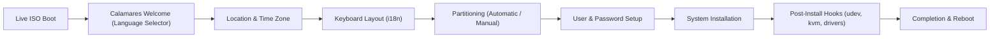
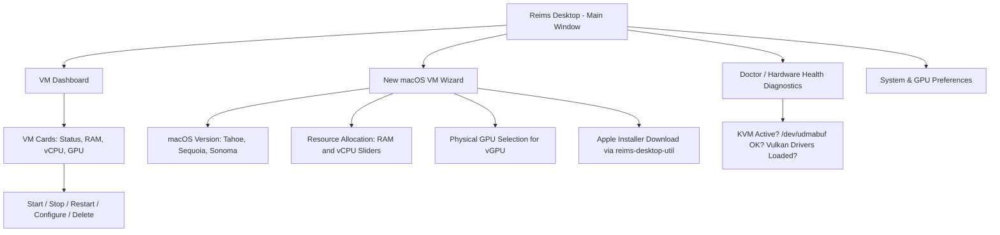
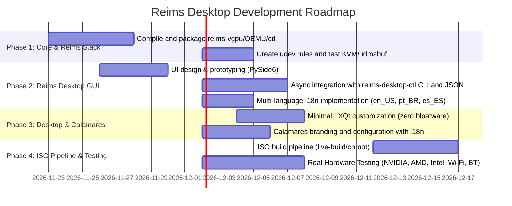

# Reims Desktop: Engineering & Architecture Plan

> **Executive Summary:**  
> This document details the technical feasibility, software architecture, and complete implementation roadmap for **Reims Desktop**: an unofficial, ultra-lightweight, bloatware-free Linux distribution based on **Ubuntu 24.04 LTS**, designed for high-performance macOS virtualization with hardware graphics acceleration via [reims-vgpu](https://github.com/steelbrain/reims-vgpu), a modern graphical installer with multi-language support (i18n), comprehensive GPU driver support (NVIDIA, AMD, Intel), and a native Qt GUI application for `reims-desktop-ctl`.
>
> *Legal Disclaimer: Reims Desktop is an independent, unofficial community project with NO connection to or affiliation with Apple Inc. or upstream Reims (steelbrain/reims-vgpu). This project distributes ZERO Apple binaries, proprietary code, or macOS installation media.*

---

## 1. System Overview & Objectives

The goal of **Reims Desktop** is to provide a turnkey operating system for users who want to run macOS virtual machines on Linux with near-native hardware GPU acceleration (Vulkan/Metal via `reims-vgpu`), without having to deal with the complexities of compiling custom kernels, configuring Vulkan drivers, patching QEMU, or manually tweaking udev and KVM permissions.

### Core Pillars:
1. **Ultra-Lightweight:** Idle RAM consumption below **350 MB – 450 MB**.
2. **Zero Bloatware:** No office suites (LibreOffice), no heavy media players, no unnecessary pre-installed browsers or games. Only essential system utilities.
3. **Hardware Ready:** Out-of-the-box detection and support for modern GPUs (NVIDIA proprietary/open-kernel, AMD RADV, Intel Iris/Arc), Wi-Fi (Intel, Broadcom, Realtek), and Bluetooth (PipeWire + audio codecs).
4. **User-Friendly Graphical Installer:** 100% graphical **Calamares** (Qt6) installer with assisted and manual partitioning and multi-language support (i18n).
5. **Integrated Reims Stack:** Kernel with `/dev/udmabuf` enabled, tuned KVM permissions, optimized binaries for `qemu-reims-vgpu`, `reims-desktop-util`, and `reims-desktop-ctl`.
6. **Reims Desktop GUI:** Dedicated, modern, and internationalized graphical interface for complete VM management via `reims-desktop-ctl`.

---

## 2. Base Distribution & Desktop Environment

### 2.1 Base System: Ubuntu 24.04 LTS ("Noble Numbat")
* **Why Ubuntu?**
  * Long-Term Support (LTS until 2029) with broad hardware compatibility (Kernel HWE 6.8 / 6.11+).
  * Excellent vendor support for proprietary GPU drivers (Canonical NVIDIA PPA / Ubuntu Drivers tool).
  * Mature Debian packaging (`.deb`) and ISO remastering pipelines (`live-build`, `debootstrap`).
  * Outstanding stability and extensive community documentation.

### 2.2 Desktop Environment: LXQt vs. XFCE Minimal vs. Labwc (Wayland)

| Criterion | LXQt 2.0 (Qt 6) *(Recommended)* | XFCE 4.18 Minimal | Labwc + Wayland |
| :--- | :--- | :--- | :--- |
| **Idle RAM Usage** | **~280 MB – 340 MB** | ~400 MB – 500 MB | ~200 MB – 260 MB |
| **Toolkit Stack** | **Qt 6** (Same stack as Calamares) | GTK 3 | Wayland / wlroots |
| **Internationalization (i18n)** | Native & comprehensive (Qt Linguist) | Complete (Gettext) | Requires custom panel setup |
| **Display/GPU Config** | Native `lxqt-config-monitor` | `xfce4-display-settings` | `wdisplays` / `kanshi` |
| **Window Manager** | Openbox or KWin-wayland/Labwc | Xfwm4 | Native Labwc |
| **Verdict** | **Ideal**: Complete technical synergy with Calamares and Qt GUI | Good, but noticeably heavier | Too bare for installer/end-user UX |

> **Architectural Decision:** Adopt **LXQt** on top of Openbox (or optional Wayland session via Labwc). LXQt uses Qt 6, ensuring visual and library consistency with both Calamares and `reims-desktop`, while keeping idle RAM consumption at historically low levels.

---

## 3. Software Matrix: What to Include vs. What to Exclude

### 3.1 Strict Inclusion List (Minimal Core)
* **Desktop & Windowing:** `lxqt-core`, `pcmanfm-qt` (lightweight file manager), `qterminal` (lightweight terminal).
* **Display / Login Manager:** `sddm` (with custom Reims Desktop theme, multi-language support, and keyboard layout picker).
* **Networking & Bluetooth:**
  * `NetworkManager` + `nm-tray` (or `cmst`).
  * `bluez` + `blueman` (graphical management of Bluetooth headphones, keyboards, and adapters).
  * `pipewire`, `wireplumber`, `pipewire-pulse`, `pavucontrol-qt` (low-latency audio with Bluetooth LDAC/AAC/SBC codec support).
* **Reims Virtualization Subsystem:**
  * Packages `reims-desktop-ctl` and `reims-desktop-util` (pre-compiled binaries in `/usr/bin`).
  * Package `qemu-reims-vgpu` (customized QEMU build with `reims-vgpu` support).
  * Package `reims-desktop` (native Qt6 graphical control center).
  * `qemu-system-x86`, `ovmf`, `swtpm`, `dnsmasq` (for native VM network bridge).
* **Installer:** `calamares` + `calamares-settings-ubuntu` module.

### 3.2 What Stays Out (Zero Bloat)
* ❌ No office suites (no LibreOffice, Calligra, etc.).
* ❌ No heavy media players (no VLC, Totem, Clementine).
* ❌ No heavy pre-installed browsers (or include an optional 1-click "Browser Installer" helper on first boot).
* ❌ No games, email clients (no Thunderbird), or Canonical telemetry packages (`ubuntu-report`, `whoopsie`, `popularity-contest` removed).
* ❌ No Snapd overhead by default (use native `.deb` packages with optional Flatpak support, reducing RAM footprint and boot latency).

---

## 4. GPU Drivers & Graphics Acceleration

Since `reims-vgpu` translates macOS Metal/OpenGL calls to **Vulkan** on the Linux host, robust Vulkan and `/dev/udmabuf` support is mandatory.

### 4.1 Driver Stack by Hardware Vendor
1. **NVIDIA:**
   * Ubuntu proprietary `restricted` repository integration.
   * Support for current architectures (`nvidia-driver-550`/`560` or `nvidia-driver-open`) and legacy GPUs.
   * `libvulkan1`, `nvidia-vulkan-common`.
   * Post-installation script for PRIME/Optimus detection and switching on hybrid laptops (`nvidia-prime`, `envycontrol`).
2. **AMD:**
   * Open-source in-kernel driver (`amdgpu`).
   * Updated `mesa-vulkan-drivers` (RADV) via Kisak/Mesa stable PPA.
   * Full Radeon GPU firmware (`linux-firmware`).
3. **Intel:**
   * Support for Intel UHD/Iris Xe and discrete Intel Arc GPUs (`i915` driver and modern `xe` module).
   * `mesa-vulkan-drivers` (ANV) and `intel-media-va-driver`.

### 4.2 Specific Reims Host Requirements
* **`udmabuf` Kernel Module:**
  * `reims-vgpu` requires `/dev/udmabuf` to map high-resolution memory buffers (4K, 60fps).
  * Configured in `/etc/modules-load.d/reims.conf`:
    ```ini
    kvm
    kvm_intel
    kvm_amd
    udmabuf
    ```
* **Udev Rules & User Permissions:**
  * File `/etc/udev/rules.d/99-reims.rules`:
    ```udev
    KERNEL=="kvm", GROUP="kvm", MODE="0660"
    KERNEL=="udmabuf", GROUP="kvm", MODE="0660"
    ```
  * The installer automatically adds the default user to the `kvm`, `render`, and `video` groups.

---

## 5. Graphical Installer (Calamares) with i18n

Instead of text-mode installers (Subiquity/TUI), Reims Desktop uses **Calamares**, the leading modular and customizable Linux installer framework.



### Specific Calamares Configurations for Reims Desktop:
1. **Language & i18n Module (`welcome.conf`):**
   * Graphical interface with 50+ languages and flag icons (English, Portuguese, Spanish, French, German, Japanese, etc.).
   * Instant UI localization update upon language selection.
2. **Keyboard Module (`keyboard.conf`):**
   * Interactive layout detection (including ABNT2, US-International, and Apple Mac ISO layouts).
3. **Hardware Check Module (`hwcheck.conf`):**
   * Visual check verifying virtualization (VT-x / AMD-V) is enabled in BIOS/UEFI.
   * Verification of a Vulkan-capable GPU.
4. **Post-Installation Module (`contextualprocess.conf`):**
   * Adds the user to the `kvm` group.
   * Generates system locales via `locale-gen`.
   * Applies display scaling and DPI settings based on the connected monitor.

---

## 6. Reims Desktop GUI: Architecture & Specifications

To eliminate reliance on terminal commands for managing VMs via `reims-desktop-ctl`, a state-of-the-art Qt GUI application is developed: **`reims-desktop`**.

### 6.1 Application Architecture
* **Language & Framework:** **Python 3.12 + PySide6 (Qt 6)**.
  * Provides native Qt6 widgets, seamless visual consistency with LXQt, clean process management, and easy maintenance.
* **Core Communication:**
  * Uses structured JSON outputs (`reims-desktop-ctl list --json`, `reims-desktop-ctl doctor`, `reims-desktop-ctl gpus`).
  * Executes CLI operations asynchronously (`QProcess` or background worker threads) without freezing the UI.

### 6.2 Application Navigation & Features



### 6.3 GUI Highlights
1. **Health Diagnostics Panel (Doctor Widget):**
   * Real-time status indicators: KVM availability, `udmabuf` module presence, Vulkan GPU detection, sufficient disk space.
2. **New VM Wizard:**
   * Supported macOS versions (macOS 26 Tahoe, macOS 15 Sequoia, macOS 14 Sonoma).
   * Smart sliders with upper bounds calculated from host physical RAM and CPU cores.
   * Dedicated GPU selector for Vulkan hardware acceleration.
   * Live download progress bar for Apple recovery images via `reims-desktop-util`.
3. **Machine Lifecycle Management:**
   * Grid or card view with real-time state.
   * Start VM (launches dedicated accelerated window), graceful ACPI shutdown, forced termination, and terminal console viewer (`reims-desktop-ctl view`).
4. **Internationalization (i18n):**
   * Integrated translation dictionaries (English `en_US`, Portuguese `pt_BR`, Spanish `es_ES`).
   * Automatic OS language detection with manual dynamic switcher in the header.

---

## 7. ISO Remastering & Build Pipeline

To build reproducible Live ISO images:

### 7.1 Build Tooling
Uses standard Debian/Ubuntu tools (`debootstrap` + `chroot` + `xorriso` / `squashfs-tools`) and automated helper scripts.

### 7.2 ISO Generation Steps:
1. **Bootstrap Base:**
   * `debootstrap --arch=amd64 noble /build/chroot http://archive.ubuntu.com/ubuntu/`.
2. **Package Configuration:**
   * Install `linux-image-generic` (or HWE), `linux-firmware`, `systemd`, `dbus`, `pipewire`, `network-manager`.
   * Install `lxqt-core`, `sddm`, `calamares`.
3. **Reims Ecosystem Injection:**
   * Install compiled `.deb` packages:
     * `/usr/bin/reims-desktop`
     * `/usr/bin/reims-desktop-ctl`
     * `/usr/bin/reims-desktop-util`
     * `/usr/bin/reims-desktop-update`
     * `/usr/lib/reims/qemu-system-x86_64` (customized QEMU with reims-vgpu)
   * Deploy application desktop shortcuts, system themes, and autostart entries.
4. **Udev Rules & Kernel Modules:**
   * Deploy `/etc/modules-load.d/reims.conf` and `/etc/udev/rules.d/99-reims.rules`.
5. **Live Environment & Calamares:**
   * Passwordless live session (`live` / `reims`).
   * Desktop shortcut: "Install Reims Desktop" (`calamares.desktop`).
6. **SquashFS Compression & ISO Creation:**
   * `mksquashfs` using `zstd` compression (high compression ratio and lightning-fast decompression).
   * Remaster hybrid ISO compatible with Legacy BIOS and UEFI via `xorriso` and `grub2`.

---

## 8. Implementation Roadmap & Milestones



---

## 9. Risk Analysis & Mitigation Strategies

| Risk / Challenge | Impact | Mitigation Strategy |
| :--- | :--- | :--- |
| **NVIDIA Proprietary Drivers on Live ISO** | High (black screen on recent GPUs) | Provide GRUB boot options with `nomodeset` / "Safe Graphics" and load `nvidia-drm.modeset=1`. |
| **`/dev/udmabuf` Permissions** | Medium (memory mapping failure in macOS) | Strict udev rules granting group permissions to `kvm`/`render` and auto-adding local user to these groups. |
| **Apple Recovery Image Downloads** | Medium (network interruptions) | Download manager with pause/resume support and fallback option to import a local DMG image. |
| **Integrated GPU Memory Limitations** | Medium | LXQt uses less than 350 MB RAM, leaving maximal system resources for the macOS VM (minimum 4 GB – 8 GB recommended). |

---

## 10. Conclusion

**Reims Desktop** bridges the gap between bleeding-edge low-level virtualization technology (`reims-vgpu`) and a seamless, turnkey user experience: transforming any compatible PC into an accelerated macOS workstation with guaranteed stability from Ubuntu LTS and unmatched agility through LXQt.
